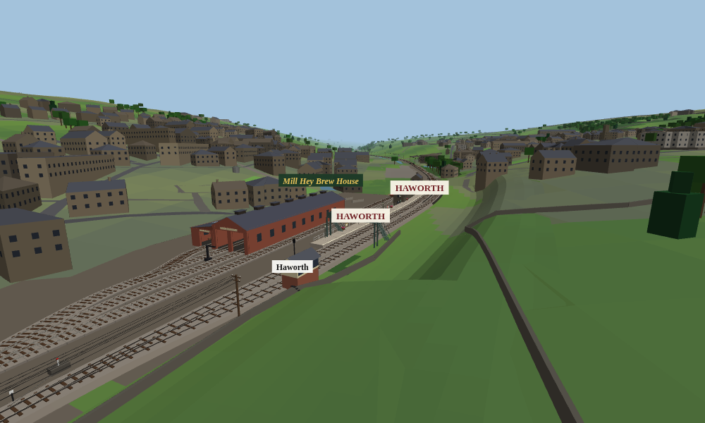
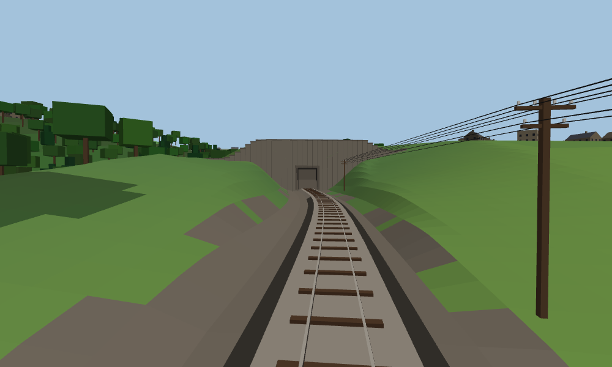
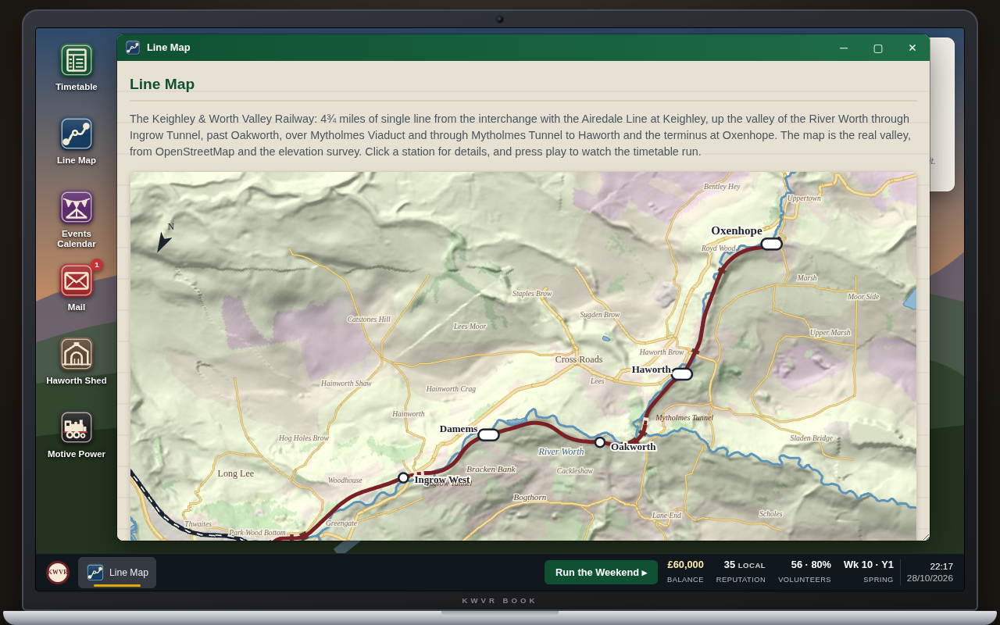
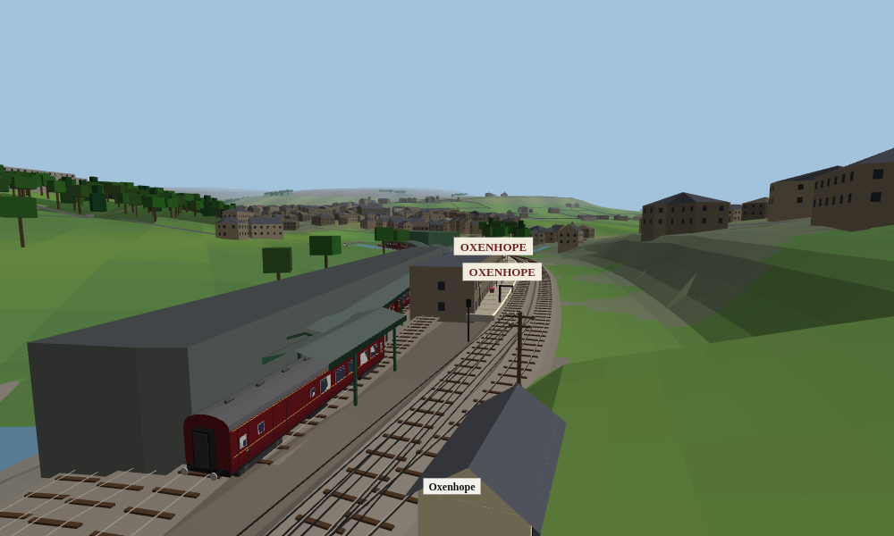
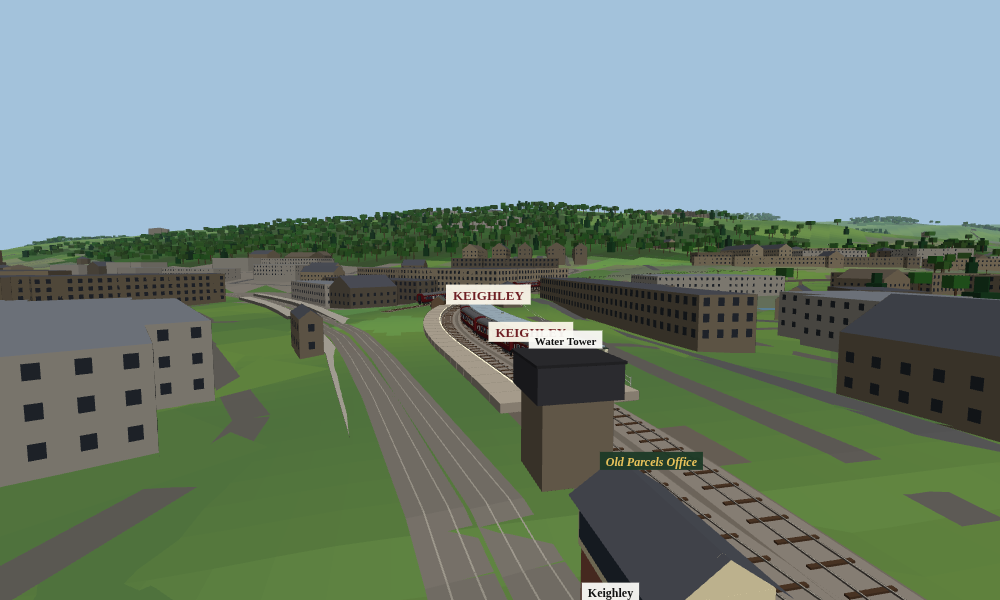
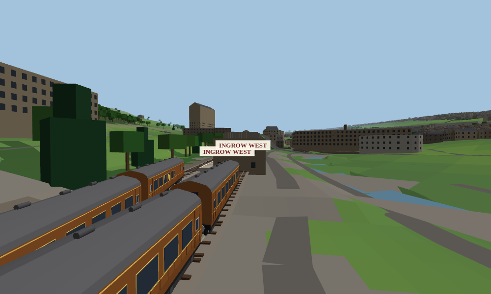

# Worth Valley Railway Manager

[Heritage Railway Manager](https://github.com/BrendanJamesLynskey/Heritage-Railway-Manager), remade as the real
**Keighley &amp; Worth Valley Railway**: 4¾ miles of single line from Keighley up the valley of the River Worth to
Haworth and Oxenhope, built one to one. Every curve of the track, every gradient, bridge and tunnel, the lie of the
land, and the valley's buildings, roads, drystone walls, woods, becks and reservoirs stand where they really are.

It plays exactly as Heritage Railway Manager does: you're general manager. You timetable the service, run steam and
diesel galas, beer and music festivals and Santa specials, keep the engines in their boiler tickets and the
volunteers happy. You can shunt the yard and drive the trains yourself. See that game's README for everything the two
share.

[Play it here](https://brendanjameslynskey.github.io/Worth-Valley-Railway-Manager/)

*An unofficial, fan-made game, not connected with the Keighley &amp; Worth Valley Railway. The people and companies who
write to you in the game are fictional.*

Everything runs in a single self-contained `index.html`, with no build step and no network after load. The world data is
packed into the page: about 1.1 MB for the line, the land and 12,000 buildings. Progress auto-saves to your browser's
local storage, under its own name, so it doesn't clash with a Heritage Railway Manager game.

## The Line

| Station | Mile | Height | Loop | What's there |
|---|---|---|---|---|
| Keighley | 0 | 97 m | ⇄ | Platforms 3 and 4 beside Network Rail's Airedale Line, platform 4's glass canopy; platform 3's road is the run-round loop, with the water tower, the turntable from Garsdale and the signal box from Bingley Junction |
| Ingrow West | 1.17 | 117 m | | The station building moved from Foulridge, the Museum of Rail Travel's vintage carriages, Ingrow Tunnel (152 m) just beyond |
| Damems | 1.86 | 134 m | ⇄ | One coach long, the level crossing and its gate box, the passing loop |
| Oakworth | 2.68 | 154 m | (buildable) | The Railway Children's station: gas lamps, enamel adverts, the level crossing and its ground frame |
| Haworth | 3.51 | 170 m | ⇄ | The railway's headquarters, the footbridge to the village, and the loco yard behind the platform with the shed and works beyond |
| Oxenhope | 4.72 | 196 m | ⇄ | The run-round loop and headshunt, the exhibition shed, the carriage shed and the roofed carriage sidings, the stone goods shed and the buffet carriage |

Between Oakworth and Haworth the line crosses the Worth on Mytholmes Viaduct and goes through Mytholmes Tunnel (69 m), on
the 1892 deviation. The climb is real too. It is 1 in 56 at its steepest, and the section gradients the timetable uses
come from the line's own rise of nearly 100 m.

## How It Was Built

The game's 3D world was built from open data, not drawn by hand:

- **The track** is the Worth Valley's running line as surveyed for [OpenStreetMap](https://www.openstreetmap.org),
  traced from aerial imagery and joined into one continuous line from the junction at Keighley to the buffer stops at
  Oxenhope.
  - It is 8.1 km long, and the station mileages come out right: Ingrow at 1¼ miles, Haworth at 3½ and Oxenhope at 4¾.
  - The platforms, both level crossings, the tunnels and the bridges are placed where OpenStreetMap has them.
  - So are the sidings and yards at Keighley, Ingrow, Oakworth and Oxenhope, and the Network Rail line through Keighley.
- **East is east.** The survey's coordinates run east, and the game's 3D world draws its x axis the other way, so the
  data is turned once as it loads. Without that the whole valley would come out as its mirror image.
- **The land** comes from the [Terrain Tiles on AWS](https://registry.opendata.aws/terrain-tiles/) elevation data. It
  covers the whole valley out to the moor tops, 14 km by 17 km, at 25 m.
  - The railway's formation is a smooth climb fitted to that land and never falls. It is cut through the hills and
    carried on embankments, with cutting sides at 1 in 1.5 and embankment sides at 1 in 2.
  - A fine strip of ground follows the line, so narrow cuttings come out properly. The tunnel portals have their own
    patches where the ground steps up to the hill over the bore.
- **The buildings** are about 12,000 OpenStreetMap footprints within a kilometre of the line. Each is raised to its
  mapped height or number of storeys.
  - Walls are blackened gritstone or slate-roofed. Small houses get hipped roofs and terraces gable roofs, the mills
    flat roofs and chimneys, the chapels towers.
  - Windows face the line.
  - Buildings over the tracks are left out, such as Keighley's booking hall on its road bridge.
- **The roads, drystone walls and hedges, woods, becks, mill ponds and reservoirs** are OpenStreetMap's too.
  - The becks and the Worth are given water levels that never run uphill, and their channels are cut into the land
    where needed.
  - The Worth falls over its weirs.
  - The woods are planted tree by tree.
- **The line map** is drawn from the same data:
  - shaded relief tinted by land cover;
  - the river, the main roads, the reservoirs and the Airedale Line;
  - the real place names.

  It's turned so the line runs from Keighley at the bottom left up the valley to Oxenhope at the top right; the arrow
  shows north.

To rebuild the data, fetch OpenStreetMap for the corridor and the terrain tiles, then run
`tools/build_kwvr_data.py <cache>` and `tools/embed_data.py <cache>`.

## What's Different From Heritage Railway Manager

- **The yard is at Haworth.** When you shunt, you're in the railway's loco yard behind Haworth's platform, where the
  real one is. The coaches are in the carriage siding along the back of the platform, and the engines are in the shed
  and works beyond it, level with the platform's Keighley half.
  It's the same Haworth you drive through, so engines not out that day stand in the shed as you pass.
- **The drive is real time.** The line isn't squeezed any more: the clock keeps real time while you're moving, and
  each way takes about a quarter of an hour at the 25 mph limit.
  - You run round your train at Oxenhope, Keighley, Damems and Haworth, wherever it turns back. Coming down from
    Oxenhope you run tender first, unless you've bought the Oxenhope turntable.
  - At Keighley the line runs on past the platforms towards the junction with the main line. Stop before you reach
    it.
- **The loops are the Worth Valley's.** The passing loops are at Keighley, Damems, Haworth and Oxenhope. You can build
  one at Oakworth to split the long section through Mytholmes Tunnel.
- **You start with 41241** in the lined Worth Valley maroon it wore when the line reopened in 1968, plus 25059 and two
  Mk1 sets.
- **Trains cross at Damems.** The starting timetable is the railway's own two-train "Orange" timetable: a steam and
  a heritage diesel train, leaving Keighley at 10:50, 11:40, 12:30, 13:30, 14:25, 15:15, 16:00 and 16:45. On every
  round they meet at Damems loop, where one train waits at the starter while the other comes down the loop beside it.
  The real steam train lays over at Oxenhope at lunchtime, so the diesel's 13:40 leaves at 13:30 here to keep the
  meeting at Damems. The Timetable's **Worth Valley Orange** button puts it back at any time with the best steam
  engine and diesel you have.
- **The run-round loops are on your right as you pull in** at both ends. At Oxenhope the loop is opposite the
  platform. At Keighley it's platform 3's road, on the Network Rail side with the water tower and the turntable, and
  platform 4 with its canopy is on the main road.
- **The carriage sidings at Oxenhope are roofed.** The coaches stand in the sidings under a steel-framed, open-sided
  roof on green stanchions, one span over each road, beside the carriage shed of the railway's Carriage & Wagon
  department.
- **Running costs are per trip.** Coal, oil and wear count each mile about three times over. A round trip on the short
  line then costs what it would on the original game's 14-mile line, so the economy plays the same.

## Credits

- Map data © [OpenStreetMap](https://www.openstreetmap.org/copyright) contributors, available under the Open Database
  Licence.
- Elevation from the [Terrain Tiles on AWS](https://registry.opendata.aws/terrain-tiles/). See its documentation for
  the attribution of its sources.
- Station details are from the Worth Valley's own station pages and Wikipedia.
- The game itself is Heritage Railway Manager.
